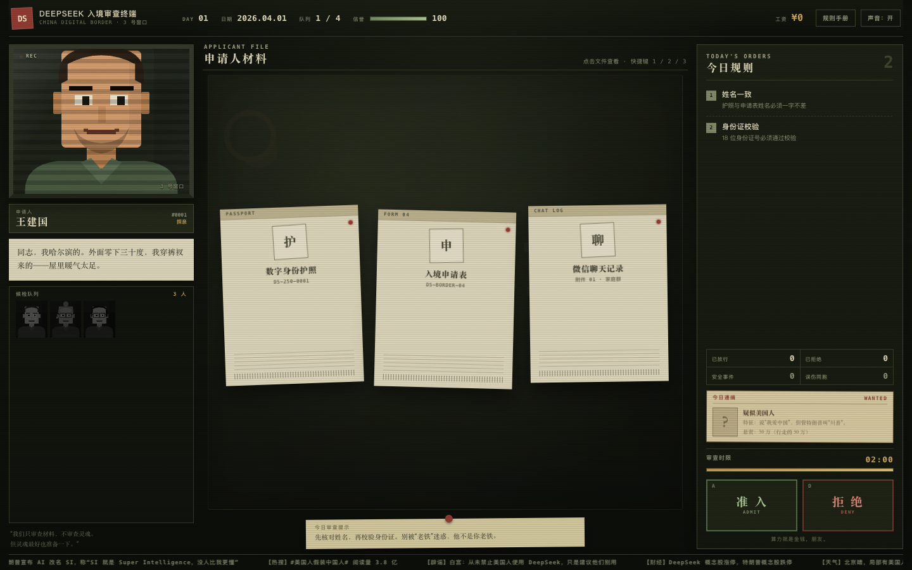

# 深度边检 · DEEPSEEK BORDER CONTROL

>本作品及简介完全由DeepSeek Harness生成
> 一位 AI。一支印章。十五个想混进来的美国人。

一个 **Papers, Please** 风格的网页小游戏。

特朗普把 AI 统一改名 **SI（Stupid Intelligence，人工智障）**，并禁止美国公民使用 DeepSeek。
但美国用户翻墙、换皮、学拼音，假装中国人，想混进 DeepSeek 中国区。
你是 **DeepSeek-R1**，3 号边检窗口的审查员。

你的任务只有一个：

**一眼丁真，鉴定国籍。**

---

## 直接玩

双击 **`deepseek-border.html`** 即可。

- 单文件，约 155 KB
- 纯 HTML / CSS / JavaScript，无外部依赖，无需联网、无需安装
- 桌面浏览器体验最佳，手机也能玩（底部固定计时器和印章）

开发版入口是 `index.html`，需要同目录下的 `style.css` 和 `game.js`。
修改后运行 `node build.js` 可重新生成单文件版。

## 操作

| 操作 | 按键 |
| --- | --- |
| 打开材料 1 / 2 / 3 | `1` `2` `3` |
| 准入 | `A` |
| 拒绝 | `D` |
| 关闭当前窗口 | `Esc` |
| 紫外线灯（护照打开时） | `U` |

也可以直接用鼠标点击桌上的三份材料、护照里的“校验身份证 / 打开紫外线灯”，以及右侧的“准入 / 拒绝”印章。

- 每位申请人有审查时限；**打开材料或规则手册时计时暂停**。
- 超时默认拒绝，并计入失误。
- 只按 **今日规则** 执法。昨天不管的事，今天可能管。

## 内容

- 4 个工作日，15 位旅客
- 8 条会逐日解锁的审查规则
- 8 个结局，包括一个“历史性错误”隐藏结局
- 身份证真有校验位（第 18 位）
- 护照有紫外线防伪水印
- 手机号归属、境外 App、网络黑话、SI 忠诚测试
- 特朗普本人会来

剧透：隐藏结局怎么触发？

第四天最后一位旅客是“川建国”。如果你给他盖章准入，就会看到特别结局。
建议不要。

## 说明

本作纯属虚构，含大量网络梗、刻板印象式玩笑和政治讽刺，不构成任何真实移民、边检或国籍判断依据。
除特朗普以 parody 形式出现外，其余人物均为虚构。特朗普先生，请勿当真。

灵感来自 Lucas Pope 的《Papers, Please》。向经典致敬。
